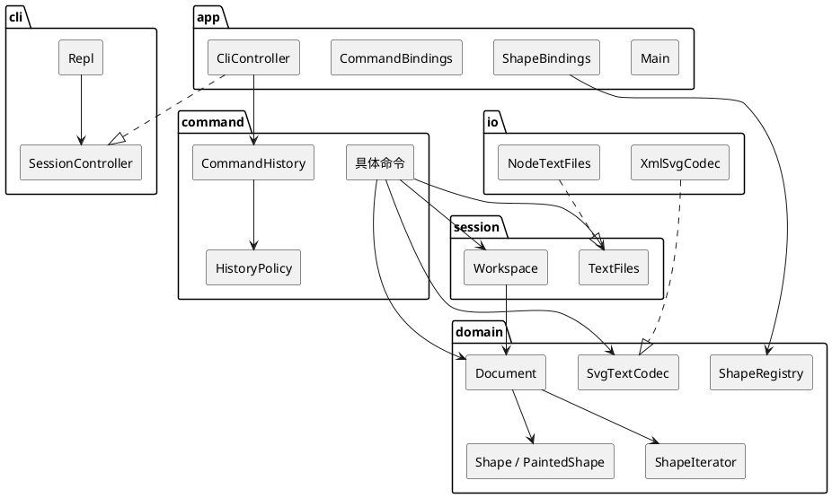

# SVGEditor

命令行矢量图编辑器。用文本命令创建、修改、分组和保存 SVG，生成的文件可以直接用浏览器打开。

本阶段实现画布、六种图形（`rect` `circle` `ellipse` `line` `text` `g`）、结构显示，以及撤销和重做。`box` 是后续插件类型，本阶段输入 `create box` 会报未知类型，内核只留下注册插槽。

## 怎么运行

需要 Node.js 22（自带 npm）。在本目录：

```bash
npm install
npm test
npm run cli
```

`npm run cli` 进入 `svg>`。`#` 开头的整行是注释。退出按 `Ctrl+D`。

演示图已经生成在 `examples/library.svg`。重新生成命令和终端记录：

```bash
npm run demo
```

终端里亲手做一遍：进入 `svg>` 后，按 `examples/library.commands` 逐行输入。浏览器打开 `examples/library.svg` 看图。截图就拍这两处。

---

## 架构方案

### 1. 模块划分

```text
src/app/        装配根：进程入口、一行文本的用例、两处按名分派
src/cli/        提示符、分词、输出
src/command/    命令对象、历史策略、撤销栈
src/session/    当前文档与保存路径，以及文件端口
src/domain/     文档、图形树、迭代、序列化、从中性元素装载
src/io/         node:fs 与 XML 库的适配器
examples/       图书馆导览演示
test/           与 src 同构的单元测试
```

| 模块 | 职责 | 不负责 |
|---|---|---|
| `app` | 创建工作区、历史栈、注册表和适配器；把一行 token 变成一次执行 | 几何规则、XML、提示符 |
| `cli` | `svg>`、整行注释、引号分词、把结果写到输出 | 判断能否撤销、修改文档 |
| `command` | 每种用户命令一个类；成功后按策略入栈 | 父子指针、id 索引、属性白名单 |
| `session` | 当前 `Document` 与默认保存路径；`TextFiles` 端口 | 图形树内部 |
| `domain` | 聚合根、组合树、创建与读取、树形文本、SVG 文本 | 磁盘、XML 库、readline、命令名 |
| `io` | `NodeTextFiles`、`XmlSvgCodec` | 业务规则、撤销 |

一类一文件，文件名等于类名。字段私有。按名字分派只有两处，文件头标了待重构：`app/CommandBindings.ts`（命令名）、`app/ShapeBindings.ts`（图形类型名）。



`Repl` 只依赖 `SessionController`。具体控制器由 `Main` 注入。

### 2. 设计模式的选择

模式只加在已经出现的变化上。下面每一条都对应代码里的类型，而不是事后贴上去的名字。

#### 命令 Command（课程要求）

请求封装成对象。`CommandHistory` 是调用者，`Document` 和 `Shape` 是接收者。具体命令只解析参数、调用接收者、记住返回的逆操作。业务规则不写在命令里。

`redo` 会再次调用 `execute()`，不是把上次的文本再打印一遍。编辑命令入 undo 栈并清空 redo 栈；`init` / `read` 清空两栈并锁定；`save` 和修改画布尺寸只锁定、保留 undo 栈；`tree` / `show` / `help` 不碰栈。锁定期间撤销和重做都是 `error: undo not allowed after io command`。下一次成功的编辑才开锁。失败的命令不入栈、不改锁。

用户不能 `ungroup` 顶层容器。撤销 `group` 走的是当时记下的逆操作，不受这条禁令限制，否则「把两个顶层图形收成一组」无法撤销。

#### 组合 Composite

`Shape` 是组件，`RectShape` 等是叶子，`GroupShape` 是组合。`move` / `scale` 在组上递归到每个子孙，每个叶子只处理一次。`SvgRoot` 是容器但不是图形：没有 id，不能被移动或删除。画布尺寸只走 `canvas` / `init` / `read`。

`front` 把图形放到同级末尾，`back` 放到开头。SVG 里后出现的兄弟画在上层。

#### 适配器 Adapter

| | XML | 文件系统 |
|---|---|---|
| 目标接口 | `SvgTextCodec` | `TextFiles` |
| 被适配者 | `@xmldom/xmldom` | `node:fs` |
| 适配器 | `XmlSvgCodec` | `NodeTextFiles` |

写出不交给 XML 库。`SvgSerializer` 按固定顺序生成声明、根元素和属性。解析结果是 `RawElement`，库的类型不出 `io`。缺 id 时按「标签名 + 序号」补上并警告。`transform` 等未知属性警告后丢弃，不烘焙进几何，避免和直接改坐标的 `move` / `scale` 叠成两次变换。

#### 工厂方法 Factory Method

`ShapeProvider.create` / `read` 由具体提供者实现。`CreateCommand` 和 `SvgLoader` 只向 `ShapeRegistry` 要一次类型，自己不区分矩形和圆。`match` 按注册逆序取第一个匹配，以后的插件后登记即可盖住内置的 `g`。

#### 策略 Strategy

`HistoryPolicy` 有四种对象：`edit`、`reset`、`lock`、`none`。`CommandHistory` 在命令成功后调用 `policy.apply`，不再自己写一串字符串分支。新增一种历史效果时，加一个策略对象，历史栈的撤销和重做循环不用改。`canvas` 不带参数时用 `none`，带尺寸时用 `lock`。

#### 模板方法 Template Method

`PaintedShape` 规定属性操作的步骤：先看是不是几何名，再看是不是文字内容，再看是不是 `fill` / `stroke` / `stroke-width`，最后才报未知属性。快照也是同一套顺序。矩形、圆、椭圆、线和文字只实现自己的字段怎么读、怎么写、怎么拍下来。外观逻辑只写在这一处。

#### 迭代器 Iterator

`ShapeIterator` 按文档前序逐个取出图形。`group` 要按这个顺序收编成员，而不是按参数书写顺序。调用方不接触容器内部数组。

#### 备忘录 Memento

`ShapeMemento` 保存一次编辑前的状态。叶子记下自己的数和外观，组记下每个子孙的备忘录。命令只调用 `restore()`。`scale` 的撤销恢复这份备忘录，不乘 `1/factor`，避免浮点走不回去。不做整份文档的快照。

#### 外观 Facade

`CliController` 是一行文本进入系统的唯一入口。分词、按名找到命令、交给历史栈、把 `EditorError` 收成一行 `error:`，都在这里结束。`Repl` 只负责提示符和打印。

#### 本阶段仍然不用的模式

| 模式 | 原因 |
|---|---|
| 访问者 | 后续要加的是图形类型。访问者会让每个新类型改遍所有操作。遍历放在组合和迭代器上，节点差异用多态 |
| 观察者 | 消费者只有 REPL，而且命令同步返回文本。第二个界面出现之后，再由文档通知视图 |
| 装饰器 | `fill` 和 `stroke` 是属性，不是包在对象外面的一层职责 |
| 单例 | 工作区、注册表、历史栈都由 `Main` 创建。测试可以再造一套 |

### 3. 依赖方向规则

```text
app → cli, command, session, domain, io
command → session, domain
session → domain
io → session, domain
domain → （不向外依赖）
cli → 只依赖自己的接口和词法
```

| 规则 | 理由 |
|---|---|
| `domain` 不依赖命令、交互、磁盘实现 | 图形规则要能脱离终端测试 |
| 命令只依赖 `TextFiles` 和 `SvgTextCodec` | 另一个入口可以复用同一批命令 |
| `cli` 不依赖命令和文档 | 提示符和引号规则的变化不带动文档 |
| 具体适配器只在 `app` 里创建 | 测试换内存文件 |
| 两处注册表的具体名单只写在 `app` | 领域里的注册表自己是空的 |
| 锁定标志在 `CommandHistory` | 文档命令不必回头调用栈 |

以下都算违反：领域代码出现命令名、`readline`、`node:fs` 或 XML 库类型；命令类 import `XmlSvgCodec` 或 `NodeTextFiles`；`Repl` import 具体图形；在 `Document` 或命令里用 `switch` / `instanceof` 区分矩形和圆；把工作区做成全局单例。

错误抛 `EditorError`，消息里已经带 `error:`。校验全部通过之后才改第一处状态。

### 4. 变化点假设

| 以后的变化 | 现在留下的缝，或决定不留的原因 |
|---|---|
| `box` 这类插件图形 | `ShapeProvider`、`matches` 逆序、组的递归操作。插件覆盖 `setAttribute`、`ungroupPolicy`、`annotation`、`extraAttributes`。本阶段不登记 `box` |
| 对齐、复制、改 id 等新命令 | 一个新命令类，再在 `CommandBindings` 登记一行，并选定一个 `HistoryPolicy`。不做命令插件加载器，没有第二个命令来源 |
| 图形界面或 agent | 仍按 id 寻址，复用同一个命令对象和 `CommandHistory`。现在不加观察者 |
| 外部 SVG 的 `transform` | 只警告并丢弃。半解析 `translate` 会让坐标看起来支持了、实际上是错的 |
| `opacity`、`font-size` 等 | 按未知属性丢弃。白名单在各图形类内部 |
| XPath 式路径寻址 | 不留。规格已排除，命令参数就是 id |
| 多人同时编辑 | 不留。撤销栈是单会话的内存序列 |
| 文案国际化 | 不留。这些英文字符串就是契约 |
| 一次改动上万个图形 | 仍由那一条命令持有更大的备忘录，不提前换成整文档快照 |
| 新的历史效果，例如「宏」 | 加一个 `HistoryPolicy`，历史栈的 undo/redo 循环不动 |

---

## 过程记录

实现分两段。先写架构方案，再写代码。第二段才把策略、模板方法、迭代器和备忘录补进已经重复的地方。

1. **命令里不能写业务。** 初稿容易把「能不能解散」「成员按什么顺序收编」写进 `GroupCommand`。这样撤销顶层分组会误走用户禁令。纠正之后，结构不变量在 `Document`，几何在 `Shape`，命令只保存 `EditResult`。撤销 `group` 用当时的逆操作，顶层禁令只约束用户输入的 `ungroup`。

2. **不要为了用访问者去遍历 SVG。** 语法树分析适合访问者，因为节点类型稳定、分析在增加。这个编辑器后面要加的是图形类型，操作集合相对固定。若用访问者，每加一种图形就要改序列化、树形显示和属性设置。现在这些都是图形自己的方法，`ShapeIterator` 只负责前序，不负责「看见矩形就做什么」。

3. **缩放的撤销不能靠乘回去。** 直接乘 `1/factor` 会留下浮点误差，树形显示对不上。命令持有 `ShapeMemento`，撤销时整段几何一起恢复。

4. **`transform` 不能读进来又只处理一部分。** 背景材料里的 SVG 用 `translate` 移动整组。本程序的 `move` 是直接改坐标。若装载时只认 `translate`、不认 `matrix`，图会看起来读对了，坐标却是错的。未知属性现在警告并丢弃。

5. **历史效果从字符串分支收成策略。** 第一版 `CommandHistory` 用 `"edit"` / `"reset"` / `"lock"` / `"none"` 四个分支决定入栈。四种行为已经稳定出现（查询、编辑、换文档、保存），再加一种就要改调用者。`HistoryPolicy` 把这四种效果变成对象，`canvas` 按有没有尺寸选择 `none` 或 `lock`。

6. **四种数值图形的属性代码重复。** 矩形、圆、椭圆、线各自复制了一遍「几何名、外观、未知属性、拍快照」。`PaintedShape` 把这个顺序固定成模板，子类只留下字段。文字的 `text` 属性走模板上的扩展点，不另写一套外观逻辑。

7. **分组顺序用迭代器，不用在 `Document` 里再写一遍递归。** 规格要求保持成员在文档中的相对顺序。`ShapeIterator` 的前序就是这个顺序。`group` 用它筛选成员，插入位置取文档顺序中的第一个成员。

---

## 一致性自查

### 模块划分

实际目录与方案一致：`app`、`cli`、`command`、`session`、`domain`、`io`，外加 `test` 和 `examples`。

第二段新增的类型没有新模块：

| 类型 | 所在模块 | 原因 |
|---|---|---|
| `HistoryPolicy` | `command` | 它只描述命令成功后栈怎么变 |
| `PaintedShape`、`ShapeIterator`、`ShapeMemento` | `domain` | 它们是图形模型的一部分 |
| `examples/` | 演示，不是运行时模块 | 命令脚本和生成的 SVG |

`SvgLoader.ts` 里有一个不导出的 `LoadIds`，只在读文件时分配 id。它不是新的公开模块。

### 依赖方向

抽查结果与规则一致：

- `src/domain` 的 import 都停在 `domain` 内部，没有命令、交互或 `io`
- `src/command` 只引用 `domain` 和 `session` 的类型，没有 `XmlSvgCodec`、`NodeTextFiles`、`Repl`
- `src/cli` 不引用 `domain`
- `src/io` 实现 `TextFiles` 和 `SvgTextCodec`，被 `app/Main.ts` 创建后注入
- `Repl` 的构造参数类型是 `SessionController`，不是 `CliController`

没有为了少传参数而把工作区做成单例。测试用 `SessionHarness` 自己装配一套内存文件。

---

## 质量保证手段

功能是否完整，对照的是命令表、错误原文和 `examples/library.commands` 这条长会话，不是只看编译通过。

`npm test` 现有 10 个测试，覆盖：

- 规格中的编辑会话：创建、分组、移动、撤销、重做、改文字、保存后禁止立刻撤销
- 非整组相邻图形的分组，以及撤销后恢复原来的兄弟顺序
- 组缩放只作用一次（外层组里还有内层组）
- 顶层容器不能 `ungroup`，嵌套组可以，撤销会按原人数再编回去
- 外部 SVG 缺 id 时的警告、七个元素的树、再保存再读回后树不变
- `transform` 被丢弃，矩形坐标仍是文件里的数
- 没有文档时的 `undo`、读不到文件时当前文档不变、`create box` 的未知类型

另外用编辑器自己把 `examples/library.commands` 跑完，得到 `examples/library.svg`（27 个图形）和 `examples/library-session.txt`。生成命令是 `npm run demo`。这条会话里有嵌套组、三种叶子、椭圆、连线、图例、整组移动和撤销、`tree` 与 `show`。

测试替身是 `MemoryTextFiles`：读和写都不碰磁盘。随机数和时钟没有进入领域模型，所以同一条命令序列的输出是稳定的。

`npx tsc --noEmit` 在严格模式下通过。失败命令在修改状态前抛错，历史栈不会记下失败的那一次。

---

## 演示：城市图书馆一楼

图里有四个区域。阅览大厅、开架书库、咖啡角各是一个组，组内有色块和标题；大厅里还有一个白色服务台圆。中庭是椭圆。三条线是读者动线。右下角是图例。

房间是容器。脚本里先把咖啡角下移 24，再 `undo`，用来在终端里看到 `g#cafe moved by (0,24)` 和 `moved back`。最终图形停在设计位置。

截两张图即可：

1. **终端。** `npm run cli`，把 `examples/library.commands` 的内容逐行贴进去。对照 `examples/library-session.txt`。重点留住 `tree`、`show desk` 和 `saved to examples/library.svg (27 elements)`。
2. **浏览器。** 打开 `examples/library.svg`（或在 macOS 上执行 `open examples/library.svg`）。应能看到米色底、三个色块房间、中庭椭圆、连线和图例。

重新生成这两个文件：

```bash
npm run demo
```
