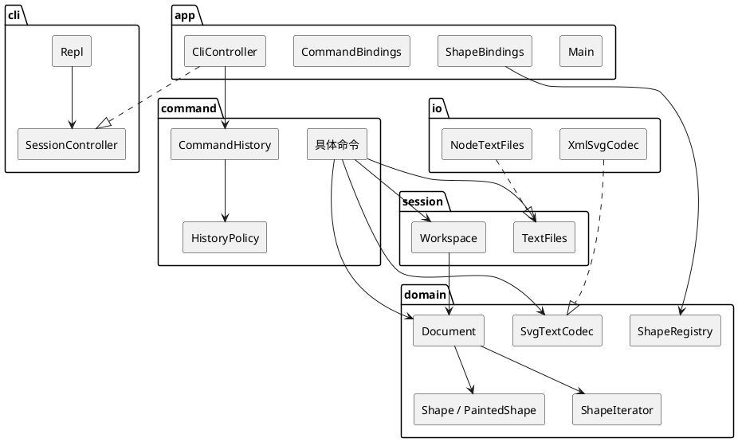
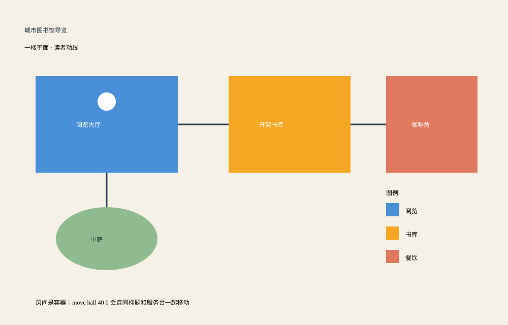

# SVGEditor

仓库：https://github.com/Iridescentttttt/SVGEditor.git

命令行矢量图编辑器。用文本命令创建、修改、分组和保存 SVG，生成的文件可以直接用浏览器打开。

本阶段实现画布、六种图形（`rect` `circle` `ellipse` `line` `text` `g`）、结构显示，以及撤销和重做。`box` 是后续插件类型，本阶段输入 `create box` 会报未知类型，内核只留下注册插槽。

## 怎么运行

需要 Node.js 22（自带 npm）。在本目录：

```bash
npm install
npm test
npm run cli
```

`npm run cli` 进入 `svg>`。`#` 开头的整行是注释。退出按 `Ctrl+D`。

演示图已经生成在 `examples/library.svg`。重新生成命令和终端记录：

```bash
npm run demo
```

终端里亲手做一遍：进入 `svg>` 后，按 `examples/library.commands` 逐行输入。浏览器打开 `examples/library.svg` 看图。截图就拍这两处。

---

## 架构方案

### 1. 模块划分

```text
src/app/        装配根：进程入口、一行文本的用例、两处按名分派
src/cli/        提示符、分词、输出
src/command/    命令对象、历史策略、撤销栈
src/session/    当前文档与保存路径，以及文件端口
src/domain/     文档、图形树、迭代、序列化、从中性元素装载
src/io/         node:fs 与 XML 库的适配器
examples/       图书馆导览演示
test/           与 src 同构的单元测试
```

| 模块 | 职责 | 不负责 |
|---|---|---|
| `app` | 创建工作区、历史栈、注册表和适配器；把一行 token 变成一次执行 | 几何规则、XML、提示符 |
| `cli` | `svg>`、整行注释、引号分词、把结果写到输出 | 判断能否撤销、修改文档 |
| `command` | 每种用户命令一个类；成功后按策略入栈 | 父子指针、id 索引、属性白名单 |
| `session` | 当前 `Document` 与默认保存路径；`TextFiles` 端口 | 图形树内部 |
| `domain` | 聚合根、组合树、创建与读取、树形文本、SVG 文本 | 磁盘、XML 库、readline、命令名 |
| `io` | `NodeTextFiles`、`XmlSvgCodec` | 业务规则、撤销 |

一类一文件，文件名等于类名。字段私有。按名字分派只有两处，文件头标了待重构：`app/CommandBindings.ts`（命令名）、`app/ShapeBindings.ts`（图形类型名）。



`Repl` 只依赖 `SessionController`。具体控制器由 `Main` 注入。

### 2. 设计模式的选择

模式只加在已经出现的变化上。每种模式对应代码里的一组类型。角色划分、调用顺序和关键实现写在 [设计模式与对应代码](doc/design-patterns.md)。

#### 命令

一次操作封装成对象，创建和执行分开。`CommandBindings` 先解析参数并装入接收者，`CommandHistory` 再调用 `execute`。怎么改树、怎么改坐标留在 `Document` 和 `Shape` 里。`MoveCommand` 只调用 `document.move`，并把返回的逆操作留在自己身上；`undo` 只执行这份逆操作。

| 角色 | 类 |
|---|---|
| 客户端 | `Main`、`CommandBindings` |
| 调用者 | `CommandHistory` |
| 命令 | `Command`；能撤销的再实现 `UndoableCommand` |
| 具体命令 | `MoveCommand` 等，一类一文件 |
| 接收者 | `Document` 管结构，`Shape` 管几何 |

`redo` 会再次调用 `execute()`，不是把上次的文本再打印一遍。失败的命令在改状态之前抛错，不会入栈。`undo` 和 `redo` 是历史栈上的方法，不会把自己再压进栈。

| 成功之后 | 命令 | 栈 |
|---|---|---|
| 入 undo 栈，清空 redo 栈，解除锁定 | `create` `delete` `move` `scale` `set` `group` `ungroup` `addto` `front` `back` | `HistoryPolicy.edit` |
| 两栈清空并锁定 | `init` `read` | `HistoryPolicy.reset` |
| 保留 undo 栈，清空 redo 栈，锁定 | `save`，以及带尺寸的 `canvas` | `HistoryPolicy.lock` |
| 不动 | `tree` `show` `help`，以及不带参数的 `canvas` | `HistoryPolicy.none` |

锁定期间撤销和重做都报 `error: undo not allowed after io command`。下一次成功的编辑才开锁。因此保存之后不能立刻撤销，但保存之后再 `move`，可以撤销这次移动，并继续撤销保存之前的编辑。`init` / `read` 已经把旧命令清掉，那些命令不会作用到新文档上。

用户不能 `ungroup` 顶层容器。撤销 `group` 不调用 `ungroup`，而是执行分组时记下的逆操作。否则把两个顶层图形收成一组之后无法撤销。

**组合。** `GroupShape` 与叶子都是 `Shape`。`move` 和 `scale` 在组上递归到每个子孙，每个叶子只处理一次。画布根不是图形，不能被移动或删除。

**适配器。** `XmlSvgCodec` 把 XML 库收成 `RawElement`，`NodeTextFiles` 把 `node:fs` 收成 `TextFiles`。领域代码不出现这两种库的类型。

**工厂方法。** 每种图形一个 `ShapeProvider`。`CreateCommand` 和读文件只向 `ShapeRegistry` 要类型，不写 `rect` / `circle` 分支。

**策略。** `HistoryPolicy` 的 `edit`、`reset`、`lock`、`none` 决定成功后栈怎么变。`canvas` 不带参数用 `none`，带尺寸用 `lock`。

**模板方法。** `PaintedShape` 固定属性校验、赋值和快照的顺序。矩形、圆、椭圆、线和文字只提供自己的字段。

**迭代器。** `ShapeIterator` 按文档前序取出图形。`group` 用这个顺序收编成员，而不是参数的书写顺序。

**备忘录。** `ShapeMemento` 记下这次会改到的子树。撤销调用 `restore()`，缩放不再乘 `1/factor`。

**外观。** `CliController` 接收一行文本，完成分词、分派和错误收集。`Repl` 只负责提示符和打印。

访问者、观察者、装饰器和单例这次没有用：后面要加的是图形类型，现在又只有一个同步的命令行入口，外观属性也不是包在对象外面的一层。

### 3. 依赖方向规则

```text
app → cli, command, session, domain, io
command → session, domain
session → domain
io → session, domain
domain → （不向外依赖）
cli → 只依赖自己的接口和词法
```

| 规则 | 理由 |
|---|---|
| `domain` 不依赖命令、交互、磁盘实现 | 图形规则要能脱离终端测试 |
| 命令只依赖 `TextFiles` 和 `SvgTextCodec` | 另一个入口可以复用同一批命令 |
| `cli` 不依赖命令和文档 | 提示符和引号规则的变化不带动文档 |
| 具体适配器只在 `app` 里创建 | 测试换内存文件 |
| 两处注册表的具体名单只写在 `app` | 领域里的注册表自己是空的 |
| 锁定标志在 `CommandHistory` | 文档命令不必回头调用栈 |

以下都算违反：领域代码出现命令名、`readline`、`node:fs` 或 XML 库类型；命令类 import `XmlSvgCodec` 或 `NodeTextFiles`；`Repl` import 具体图形；在 `Document` 或命令里用 `switch` / `instanceof` 区分矩形和圆；把工作区做成全局单例。

错误抛 `EditorError`，消息里已经带 `error:`。校验全部通过之后才改第一处状态。

### 4. 变化点假设

| 以后的变化 | 现在留下的缝，或决定不留的原因 |
|---|---|
| `box` 这类插件图形 | `ShapeProvider`、`matches` 逆序、组的递归操作。插件覆盖 `setAttribute`、`ungroupPolicy`、`annotation`、`extraAttributes`。本阶段不登记 `box` |
| 对齐、复制、改 id 等新命令 | 一个新命令类，再在 `CommandBindings` 登记一行，并选定一个 `HistoryPolicy`。不做命令插件加载器，没有第二个命令来源 |
| 图形界面或 agent | 仍按 id 寻址，复用同一个命令对象和 `CommandHistory`。现在不加观察者 |
| 外部 SVG 的 `transform` | 只警告并丢弃。半解析 `translate` 会让坐标看起来支持了、实际上是错的 |
| `opacity`、`font-size` 等 | 按未知属性丢弃。白名单在各图形类内部 |
| XPath 式路径寻址 | 不留。规格已排除，命令参数就是 id |
| 多人同时编辑 | 不留。撤销栈是单会话的内存序列 |
| 文案国际化 | 不留。这些英文字符串就是契约 |
| 一次改动上万个图形 | 仍由那一条命令持有更大的备忘录，不提前换成整文档快照 |
| 新的历史效果，例如「宏」 | 加一个 `HistoryPolicy`，历史栈的 undo/redo 循环不动 |

---

## 过程记录

和 AI 协作时，我把它给出的方案和代码都当成需要核对的草稿。下面每条都是我在文档或生成结果里看到的问题、用什么确认，以及最后改成了什么。

1. **撤销顶层分组走了用户命令。** AI 写的 `GroupCommand.undo` 直接调用 `document.ungroup`。我用会话核对：`init` 之后 `create rect a`、`create rect b`、`group g a b`，这个新组是画布的直接子节点。再 `undo`，输出是 `error: cannot ungroup top-level container: g`，图形并没有还原。规格只禁止用户解散顶层容器，并没有禁止撤销这次 `group`。纠正：`Document.group` 在修改前记下各成员原来的父容器和顺序，命令只保存这份逆操作。顶层禁令只留在用户输入的 `ungroup` 上。
2. **用访问者遍历 SVG。** 架构草稿建议给序列化、`tree`、`show` 各写一个 Visitor，理由是课程刚用语法树讲过这个模式。我对照的是后面的变化方向：`box` 要作为新类型加进来，操作却还是原来那几种。访问者每加一种图形就要改全部 `visit`。确认方式是在草稿里数改动面：加 `box` 至少要动写文件、树和属性三处。现在遍历只用 `ShapeIterator` 做前序，节点差异放在图形自己的方法上。
3. **撤销缩放靠再乘一次倒数。** AI 的 `ScaleCommand` 在 `undo` 里执行 `scale(1/factor)`。我用 `scale c1 0.1` 连续做三次再逐次撤销，`show` 里的半径变成 `10.000002`，和创建时的 `10` 对不上。纠正：执行前由图形交出 `ShapeMemento`，撤销只调用 `restore()`。组的备忘录包含每个子孙，不会把整份文档复制一份。
4. **读入时解析** `transform`**。** 生成的 `SvgLoader` 只识别 `translate(dx,dy)`，把它加进子图形坐标。规格背景里的 SVG 还有 `scale`，样例文件里两种会嵌套。我用只含 `translate(60,40)` 的小组试读，坐标被改了；若之后再 `move`，同一次位移会作用第二次。只支持一种函数还会让 `matrix(...)` 被静默丢掉。纠正：不认识的属性（含 `transform`）警告后丢弃，几何保持文件里的原数。
5. **树的空格照着讲义样例硬对齐。** AI 把 `tree` 的 `类型#id` 垫到固定列宽，想和讲义里的空格一致。我把讲义两段 `tree` 放在一起数空格：`rect#bg` 和 `circle#c1` 后面的空格数并不相同，后一段流程图里的 `line#arrow1` 也和前一段不一样。列宽对不齐测试，也不是规格正文里的规则。纠正：`类型#id` 与几何之间固定两个空格，测试只断言前缀、id 和属性。
6. **查询画布尺寸也锁住撤销。** 第一版把整个 `canvas` 命令都标成 `lock`。我按规格 4.3 核对：锁住撤销的是「修改尺寸」，无参数的 `canvas` 只显示大小。会话是 `move` 之后执行 `canvas`（不带参数）再 `undo`，结果误报 `undo not allowed after io command`，上一次移动无法撤销。纠正：不带尺寸时策略是 `HistoryPolicy.none`，带尺寸时才是 `lock`。
7. **分组顺序跟参数书写顺序走。** AI 按 `group g c a` 的参数顺序把 `c` 放在 `a` 前面。文档里原来的顺序是 a、b、c。我看 `tree`，收编后 c 盖住了 a，和「保持相对顺序」相反。纠正：`ShapeIterator` 按前序取出图形，`group` 只按这个顺序挑成员，新组插在文档顺序中第一个成员原来的位置。
8. **外层组缩放乘了两次。** 生成的 `GroupShape.scale` 先把自己的子节点缩放一遍，子组的 `scale` 里又对叶子做了一次。构造 `outer > inner > rect(x=10)` 后执行 `scale outer 2`，`show` 里 x 变成 40 而不是 20。纠正：组只把 `scale` 转给直接子节点，叶子各自乘一次。这条留在测试里。
9. **工作区做成单例，省掉构造参数。** AI 为了少写依赖，加了 `Workspace.getInstance()`，命令在内部自己取。我同时跑两个测试：一个 `init 800 600`，一个 `init 100 80`，第二个测试读到了第一个的画布尺寸。单例把两次会话接在了一起。纠正：`Main` 创建工作区并传进命令；测试各自 `new` 一套，并换上 `MemoryTextFiles`。
10. **行尾** `#ffffff` **被当成注释。** 词法草稿把第一个 `#` 之后都删掉。`create rect bg 0 0 800 600 #ffffff` 在分词后丢掉了填充色，矩形变成默认黑，`tree` 里没有 `fill=#ffffff`。规格里的 `#` 注释写的是「开头」。纠正：只有去掉空白后整行以 `#` 开头才忽略，参数中的颜色保留。

---

## 一致性自查

### 模块划分

实际目录与方案一致：`app`、`cli`、`command`、`session`、`domain`、`io`，外加 `test` 和 `examples`。

第二段新增的类型没有新模块：

| 类型 | 所在模块 | 原因 |
|---|---|---|
| `HistoryPolicy` | `command` | 它只描述命令成功后栈怎么变 |
| `PaintedShape`、`ShapeIterator`、`ShapeMemento` | `domain` | 它们是图形模型的一部分 |
| `examples/` | 演示，不是运行时模块 | 命令脚本和生成的 SVG |

`SvgLoader.ts` 里有一个不导出的 `LoadIds`，只在读文件时分配 id。它不是新的公开模块。

### 依赖方向

抽查结果与规则一致：

- `src/domain` 的 import 都停在 `domain` 内部，没有命令、交互或 `io`
- `src/command` 只引用 `domain` 和 `session` 的类型，没有 `XmlSvgCodec`、`NodeTextFiles`、`Repl`
- `src/cli` 不引用 `domain`
- `src/io` 实现 `TextFiles` 和 `SvgTextCodec`，被 `app/Main.ts` 创建后注入
- `Repl` 的构造参数类型是 `SessionController`，不是 `CliController`

没有为了少传参数而把工作区做成单例。测试用 `SessionHarness` 自己装配一套内存文件。

---

## 质量保证手段

功能是否完整，对照的是命令表、错误原文和 `examples/library.commands` 这条长会话，不是只看编译通过。

`npm test` 现有 10 个测试，覆盖：

- 规格中的编辑会话：创建、分组、移动、撤销、重做、改文字、保存后禁止立刻撤销
- 非整组相邻图形的分组，以及撤销后恢复原来的兄弟顺序
- 组缩放只作用一次（外层组里还有内层组）
- 顶层容器不能 `ungroup`，嵌套组可以，撤销会按原人数再编回去
- 外部 SVG 缺 id 时的警告、七个元素的树、再保存再读回后树不变
- `transform` 被丢弃，矩形坐标仍是文件里的数
- 没有文档时的 `undo`、读不到文件时当前文档不变、`create box` 的未知类型

另外用编辑器自己把 `examples/library.commands` 跑完，得到 `examples/library.svg`（27 个图形）和 `examples/library-session.txt`。生成命令是 `npm run demo`。这条会话里有嵌套组、三种叶子、椭圆、连线、图例、整组移动和撤销、`tree` 与 `show`。

测试替身是 `MemoryTextFiles`：读和写都不碰磁盘。随机数和时钟没有进入领域模型，所以同一条命令序列的输出是稳定的。

`npx tsc --noEmit` 在严格模式下通过。失败命令在修改状态前抛错，历史栈不会记下失败的那一次。

---

## 演示：城市图书馆一楼

图里有四个区域。阅览大厅、开架书库、咖啡角各是一个组，组内有色块和标题；大厅里还有一个白色服务台圆。中庭是椭圆。三条线是读者动线。右下角是图例。

房间是容器。脚本里先把咖啡角下移 24，再 `undo`，用来在终端里看到 `g#cafe moved by (0,24)` 和 `moved back`。最终图形停在设计位置。

### Code

```
init 1000 640
create rect paper 0 0 1000 640 #f6f1e7
create text title 48 64 "城市图书馆导览"
set title fill #243044
create text subtitle 48 98 "一楼平面 · 读者动线"

create g hall
create rect hall-body 70 150 280 190 #4a90d9 in hall
create text hall-label 150 250 "阅览大厅" in hall
set hall-label fill #ffffff
create circle desk 210 200 18 #ffffff in hall

create g stacks
create rect stacks-body 450 150 240 190 #f5a623 in stacks
create text stacks-label 510 250 "开架书库" in stacks
set stacks-label fill #ffffff

create g cafe
create rect cafe-body 760 150 180 190 #e07a5f in cafe
create text cafe-label 810 250 "咖啡角" in cafe
set cafe-label fill #ffffff

create ellipse garden 210 470 100 62 #8fbc8f
create text garden-label 178 476 "中庭"
set garden-label fill #1f3d2a

create line to-stacks 350 245 450 245 #334155
set to-stacks stroke-width 3
create line to-cafe 690 245 760 245 #334155
set to-cafe stroke-width 3
create line to-garden 210 340 210 408 #334155
set to-garden stroke-width 3

create g legend
create rect key-hall 760 400 26 26 #4a90d9 in legend
create text key-hall-name 798 420 "阅览" in legend
create rect key-stacks 760 446 26 26 #f5a623 in legend
create text key-stacks-name 798 466 "书库" in legend
create rect key-cafe 760 492 26 26 #e07a5f in legend
create text key-cafe-name 798 512 "餐饮" in legend
create text legend-title 760 384 "图例"

create text hint 70 600 "房间是容器：move hall 40 0 会连同标题和服务台一起移动"

move cafe 0 24
undo
tree
show desk
save examples/library.svg
```

### Results



重新生成文件：

```bash
npm run demo
```
