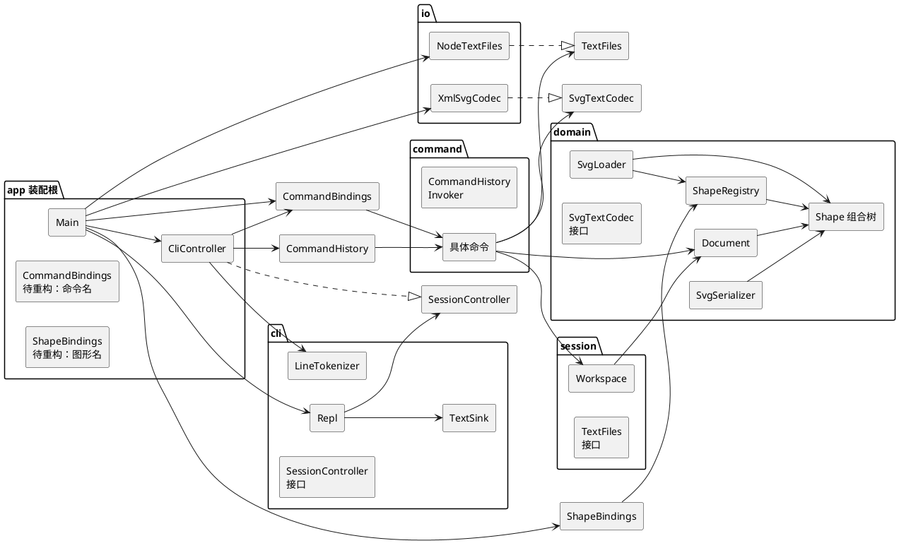
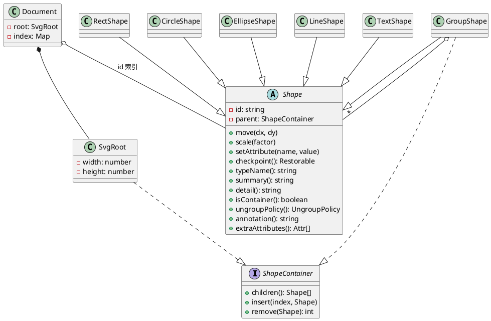
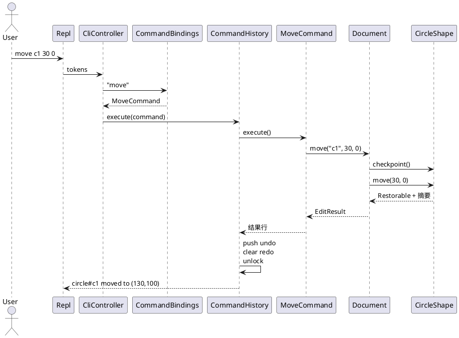

# Lab1 Phase 1：SVG 编辑器（CLI）架构方案

> 状态：仅架构方案。过程记录、一致性自查、质量保证在实现完成后再写。
>
> 本阶段实现 `init` / `read` / `save` / `canvas`、六种内置图形（`rect` `circle` `ellipse` `line` `text` `g`）以及编辑、显示、撤销重做。`box` 是后续插件阶段的目标，本阶段 `create box` 报未知类型；方案里只留插槽，不实现插件。

## 总判断

系统按「文档—图形树—命令—会话」分解，而不是按「解析一行、改几个字段、打印」拆成过程。

| 决策 | 选择 |
|---|---|
| 谁持有业务规则 | `Document` 管树的结构不变量，`Shape` 管自身几何与属性。命令不写这些规则 |
| 请求如何进入系统 | 命令对象。`CommandHistory` 统一执行，并维护 undo / redo |
| 容器与叶子如何共用 `move` / `scale` / `delete` | 组合结构。`GroupShape` 与叶子都是 `Shape`，画布根不是图形 |
| 外部 XML、磁盘如何进来 | 适配器。领域只看见 `RawElement` 和字符串 |
| 新图形类型从哪里进入 | 唯一的 `ShapeRegistry`。本阶段登记六个内置类型 |
| 撤销记什么 | 命令持有「这一次操作的逆操作」。只覆盖被碰到的子树，不给整份文档做快照 |
| 图形上的多种只读操作 | 放在图形自己的方法上（摘要、明细、写出属性）。本阶段不引入访问者 |
| 界面与文档的同步 | 命令返回文本，REPL 负责打印。本阶段只有一个同步调用者，不引入观察者 |

规格允许按名字分派的只有两处，且必须标成待重构：

1. `app/CommandBindings.ts`：命令名 → 命令对象
2. `app/ShapeBindings.ts`：类型名 / SVG 标签 → `ShapeProvider`

领域、命令、读写过程里不再出现第二套 `switch(type)` 或 `instanceof` 分派。

---

## 1. 模块划分

### 1.1 目录与职责

```text
src/
  app/          装配根：进程入口、一行文本的用例、两处按名分派
  cli/          交互：提示符、词法、标准输出。不知道图形和文件
  command/      命令对象与历史栈（调用者）
  session/      当前文档与当前路径
  domain/       文档、图形组合树、SVG 语义、纯文本加载与序列化
  io/           把 node:fs 和 XML 解析库适配成领域接口
test/           与 src 同构的单元测试
doc/            本说明
```

| 模块 | 职责 | 不负责 |
|---|---|---|
| `app` | 创建工作区、历史栈、注册表和适配器；把一行 token 变成一次 `CommandHistory.execute` | 几何规则、XML 细节、提示符格式 |
| `cli` | `svg>` 提示符、启动横幅、整行注释、引号分词、把结果写到输出 | 判断 undo 是否合法、修改文档 |
| `command` | 每种用户命令一个类：解析自己的参数、调用接收者、按历史策略被记录 | 父子指针、id 索引、属性白名单 |
| `session` | `Workspace`：当前 `Document` 与默认保存路径；`TextFiles` 端口 | 图形树内部结构 |
| `domain` | 聚合根、组合树、创建/读取图形、树形文本、SVG 文本的结构 | 磁盘、XML 库、readline、命令名 |
| `io` | `NodeTextFiles`、`XmlSvgCodec` | 业务规则、撤销 |

一类一文件，文件名等于类名。字段私有。不设「工具函数文件」。`main` 的进程入口是 `app/Main.ts`。

`package.json` 的 `npm run cli` 启动 `Main`。测试只依赖各模块的公开类型，并用内存文件和记录型输出替换端口。

### 1.2 运行时谁创建谁

`Main` 是客户端里唯一的装配点：

1. 创建 `ShapeRegistry`，由 `ShapeBindings` 登记六个内置 `ShapeProvider`
2. 创建 `XmlSvgCodec`、`NodeTextFiles`、空的 `Workspace`、`CommandHistory`
3. 创建 `CommandBindings`，把命令名绑到各命令类的 `parse`
4. 创建 `CliController`（实现 `cli` 里的 `SessionController`），交给 `Repl`

一次按键回车的路径：

```text
Repl
  → LineTokenizer          空行与整行 # 注释在此结束
  → CliController
       → CommandBindings   命令名分派（待重构点 1）
       → CommandHistory    执行、入栈、锁定
            → Command
                 → Workspace / Document / Shape
                 → TextFiles / SvgTextCodec   仅 init 以外的文档命令需要
```

`undo` 与 `redo` 不做成会把自己压栈的命令。它们是 `CommandHistory` 的两个方法，仍由 `CommandBindings` 这一处按名字转过去。

### 1.3 包图

箭头表示编译期可以 import 的方向。



`Repl` 只依赖 `SessionController`。具体的 `CliController` 由 `Main` 注入。这样交互模块不会回头依赖命令或文档。

---

## 2. 设计模式如何落地

### 2.1 命令（必须使用）

采用的是「入口完全委托」那一档：业务在接收者，命令只转发，调用者决定何时执行以及是否入栈。

| 角色 | 落地 | 职责 |
|---|---|---|
| Client | `Main` + `CommandBindings` | 创建命令，把工作区和端口装进命令 |
| Invoker | `CommandHistory` | `execute` / `undo` / `redo`，两栈，锁定标志 |
| Command | `Command` | `execute()` 与 `historyPolicy()` |
| UndoableCommand | 编辑命令 | 额外的 `undo()` |
| ConcreteCommand | `MoveCommand` 等，一类一文件 | 解析本命令的 token；调用接收者；记住本次返回的逆操作 |
| Receiver | `Document` 与 `Shape` | 结构不变量在文档，几何与属性在图形 |

编辑命令的形状：

```text
execute:
  校验参数（仍不改文档）
  edit = document.move(id, dx, dy)     # 接收者完成规则，并返回逆操作
  保存 edit
  返回 edit 的结果行

undo:
  返回 edit.undo()                     # 逆操作由接收者在当时生成
```

`redo` 不是把上一次的文本再打印一遍，而是再次调用 `execute()`。调用者保证同一条命令严格按「执行 → 撤销 → 再执行」交替。新的编辑会清空 redo 栈。

逆操作是接收者返回的 `Restorable`，命令看不见几何字段。`Shape.checkpoint()` 只拍下本次会改到的子树：叶子记下自己的几何，容器递归记下子孙。删除、分组、调整顺序则由 `Document` 记下父容器和索引。不使用整文档快照。

#### 哪些命令入栈

| 策略 `historyPolicy` | 命令 | 成功之后 |
|---|---|---|
| `edit` | `create` `delete` `move` `scale` `set` `group` `ungroup` `addto` `front` `back` | 压入 undo 栈，清空 redo 栈，解除锁定 |
| `reset` | `init` `read` | 两栈清空，并锁定。旧命令引用的是上一份文档，不能再执行 |
| `lock` | `save`；`canvas` 的修改尺寸 | 保留 undo 栈，清空 redo 栈，锁定 |
| `none` | `tree` `show` `help`；`canvas` 不带参数 | 两栈与锁定标志都不变 |

锁定期间 `undo` / `redo` 一律：

```text
error: undo not allowed after io command
```

下一次**成功的编辑命令**解除锁定。失败的命令不入栈、不锁定、也不解锁。因此「保存之后先撤销」会失败；保存之后再 `move`，可以撤销这次 `move`，并继续撤销保存之前的编辑。`init` / `read` 因为已经清空栈，解锁后也不会把上一份文档的命令应用到新文档上。

没有文档时，除 `init`、`read`、`help` 外都失败，并且优先于锁定判断：

```text
error: no document. use 'init' or 'read' first
```

撤销栈为空且未锁定：`error: nothing to undo`。重做栈为空且未锁定：`error: nothing to redo`。这两条是规格表之外、实现所必需的反馈。

用户输入的 `ungroup` 不能解散顶层容器，也不能解散复合图形。撤销一条 `group` 时走的是当时记下的逆操作，不受这条用户禁令限制。否则「把两个顶层图形收成一组」将无法撤销。

#### 命令与接收者的分工

| 命令 | 命令自己保存的参数 | 接收者做的事 |
|---|---|---|
| `create` | 类型名、id、原始参数、可选父 id | 登记表创建图形；检查 id；挂到父容器末尾 |
| `delete` | id | 从父容器摘下整棵子树，移出 id 索引，记住位置 |
| `move` / `scale` | id、位移或比例 | 图形（容器则递归子孙）修改几何，先拍检查点 |
| `set` | id、属性名、新值 | 图形按自己的白名单修改；先读旧值 |
| `group` | 新 id、成员 id 列表 | 祖先检查、按文档原顺序收编、插入新容器 |
| `ungroup` | 容器 id | 顶层禁令、复合图形禁令、子节点升到原位置 |
| `addto` | 容器 id、图形 id | 循环检查，插到目标容器末尾 |
| `front` / `back` | id | 在同级子列表中移到末尾 / 开头 |
| `init` | 宽高 | 换上新文档，路径清空 |
| `read` | 路径 | 读文本、解析、装载；成功后更换文档并记下路径 |
| `save` | 可选路径 | 序列化并写入；省略路径时用当前路径 |
| `canvas` | 可选宽高 | 查询或只改画布宽高与 viewBox |
| `tree` / `show` | 可选或必需的 id | 生成规格中的文本 |
| `help` | 无 | 按注册顺序输出用法 |

`create` 的类型名只在 `ShapeRegistry` 查询一次。`CreateCommand` 不认识 `rect` 与 `circle` 的差别。

### 2.2 组合：容器与叶子统一操作



`SvgRoot` 是容器，但不是 `Shape`。它没有 id，不能被 `move`、`delete`、`group`。画布尺寸只通过 `canvas` / `init` / `read` 改变。这样叶子与 `<g>` 的统一操作不必为根节点再写特例。

结构不变量全部收在容器的 `insert` / `remove` 和 `Document` 的索引维护里：

- 每个图形 id 全局唯一、大小写敏感，索引是唯一入口
- 在树上 ⟺ 出现在父容器的子列表中，且 id 在索引中
- 被删除的对象只被撤销令牌引用，id 不保留占用。之后可以用同一 id 再 `create`；按栈的顺序先撤销创建、再撤销删除，不会撞 id
- 父子指针只由容器改。外部不能替换公开的子数组
- `front` 移到同级末尾，`back` 移到同级开头。SVG 中后出现的兄弟画在上层
- 分组时若某个成员是另一个成员的祖先：`error: cannot group a container into its own descendant: <祖先id>`
- `addto` 把容器放进自己的子孙：`error: cannot move a container into its own descendant: <id>`
- 新分组插在「文档顺序中第一个成员」原来的位置，成员按原来的文档顺序进入新组，而不是按参数书写顺序
- `ungroup` 把子节点按原顺序插到该组所在的索引，组本身删除
- `scale` 把该图形每一个几何数乘上因子（相对原点，不是绕中心）。容器递归到每个子孙，每个叶子只乘一次。因子必须为正：`error: scale factor must be positive`
- `move` 只加位移，不改宽高和半径。容器同样只递归一次

`set` 的白名单在具体图形里，不在命令里：

| 类型 | 可设置 |
|---|---|
| rect | `x` `y` `width` `height` `fill` `stroke` `stroke-width` |
| circle | `cx` `cy` `r` `fill` `stroke` `stroke-width` |
| ellipse | `cx` `cy` `rx` `ry` `fill` `stroke` `stroke-width` |
| line | `x1` `y1` `x2` `y2` `fill` `stroke` `stroke-width` |
| text | `x` `y` `text` `fill` `stroke` `stroke-width` |
| g | 本阶段没有可设置属性 |

白名单之外：`error: unknown attribute: <attr>`。未出现过的 `fill` / `stroke` 保持「未设置」，序列化和 `show` / `tree` 都省略它，从而保留 SVG 默认外观。

`annotation()` 默认返回空串。树形文本直接拼接它。以后的 `box` 返回 ` (box)`，呈现代码不用改。`extraAttributes()` 默认返回空。`box` 以后从这里写出 `data-kind="box"`。`ungroupPolicy()` 对普通组返回可解散，对插件复合图形返回不可解散。

### 2.3 适配器：XML 与文件系统

领域定义目标接口，外部库留在 `io`。

| 角色 | XML | 文件系统 |
|---|---|---|
| Target | `SvgTextCodec`：`parse(text) → RawElement`，`format(document) → text` | `TextFiles`：`read(path)` / `write(path, text)` |
| Adaptee | XML 解析库（实现时用保持元素顺序的 DOM 解析器） | `node:fs` |
| Adapter | `XmlSvgCodec` | `NodeTextFiles` |
| Client | `ReadCommand`、`SaveCommand`、`SvgLoader`、`SvgSerializer` | `ReadCommand`、`SaveCommand` |

`format` 不委托给 XML 库。写出顺序是本编辑器的契约，由 `SvgSerializer` 按下面的顺序自己生成，适配器只把字符串交给它：

1. XML 声明：`<?xml version="1.0" encoding="UTF-8"?>`
2. 根元素带 `xmlns`、`width`、`height`、`viewBox="0 0 W H"`
3. 图形属性顺序：`id`、该类型的几何属性、已设置的 `fill`、`stroke`、`stroke-width`，然后才是 `extraAttributes()`
4. 空元素自闭合；`text` 的内容是转义后的子文本；两空格缩进

`parse` 把库的节点翻译成不可变的 `RawElement`（标签、属性、文本、有序子元素）。库的类型不得出现在 `io` 以外。

读取子集：`svg`、`g`、`rect`、`circle`、`ellipse`、`line`、`text` 以及上表中的属性。这是规格样例和本程序自己 `save` 的并集。

- 缺 id：按标签名加从 1 开始的序号分配第一个空闲 id，并打印 `warning: assigned id rect1 to unnamed <rect>`
- 不认识的属性（含 `transform`、`data-kind`）：丢弃并 `warning: ignored attribute <name> on <tag>`。不把 `transform` 半解进几何，避免和「直接改几何」的 `move` / `scale` 叠成两次变换
- 不认识的标签、缺必需几何、根不是 `svg`、文件中的 id 重复：整次 `read` 失败，当前文档保持原样
- `viewBox` 与宽高不一致时以宽高为准，并警告 viewBox 被忽略

`DocumentFiles` 这类「读路径直接返回文档」的合并接口不采用。解析、装载、磁盘分成三步之后，装载可以用内存中的 `RawElement` 测试，不必准备真实文件。

### 2.4 两处工厂，以及待重构标记

`ShapeProvider`：

```text
typeName                         "rect"
svgTag                           "rect"
matches(raw) → boolean           本阶段：标签相等
create(id, args) → Shape         校验该类型的参数并构造
read(raw, children) → ReadPiece  由已解析的中性元素构造，并带回警告
usage of create                  给 help 用的参数片段
```

`ShapeRegistry.byName` 与 `ShapeRegistry.match` 是同一张表的两个查询。`match` 按**注册逆序**取第一个匹配。本阶段只有标签匹配，逆序还不会改变结果；插件阶段让 `box` 后注册，并让它的 `matches` 识别 `g` 加 `data-kind="box"`，未注册时内置 `g` 仍接收这种元素，语义降级为普通组。

`ShapeBindings.registerBuiltins` 是图形名分派的唯一位置，文件头注明「待重构」。命令名的唯一位置是 `CommandBindings.registerBuiltins`，同样注明。替换方向是：提供者或命令自己向注册表登记，调用点保持「按名查找」而不是在业务方法里加分支。在那次重构发生之前，不允许再增加第三处名字分派。

`help` 按登记顺序打印每条命令的 `usage`，不另写一份命令清单。

### 2.5 本阶段不采用的模式

这些模式在课程里已经学过。这里写明条件为何不成立，避免实现时为了「用上模式」把结构加厚。

| 模式 | 本阶段的判断 |
|---|---|
| 访问者 | 后续变化是增加图形类型（`box` 及别的插件），操作集合相对固定。访问者会在每个新类型上修改全部已有操作。树的遍历放在 `GroupShape`，节点差异用多态方法 |
| 观察者 | 状态变化的消费者只有 REPL 这一处，而且是同步返回文本。没有一组动态视图需要通知。图形界面出现时，再让文档在变更后通知视图；命令对象仍然是修改入口 |
| 装饰器 | 没有「给单个对象叠一层、还可拆掉」的职责。`fill` 与 `stroke` 是属性，不是包装 |
| 策略 | 几何算法不需要在运行时替换。类型差异由子类表达 |
| 备忘录框架 | 撤销状态就是命令持有的 `Restorable`。不再做统一的文档快照管理器 |
| 单例 | 工作区、注册表、历史栈都由 `Main` 创建并传入。测试可以平行创建第二套，不从全局取 |

脚本回放使用规格已经给出的方式：以 `#` 开头的文本脚本逐行送进同一个 REPL。不另做宏记录器。

---

## 3. 依赖方向规则

允许的方向只有：

```text
app → cli, command, session, domain, io
cli → （仅自己的接口与词法；不依赖 app 的具体类）
command → session, domain
session → domain
io → session, domain
domain → （无向外的依赖）
```

| 规则 | 理由 |
|---|---|
| `domain` 不依赖 `command`、`cli`、`io`、`session` | 图形规则要能脱离终端和磁盘测试。文档不知道「谁在撤销」 |
| `command` 不依赖 `cli` 与 `io` 的具体类 | 命令可以被另一个入口复用。它只依赖 `TextFiles`、`SvgTextCodec` 这两个端口 |
| `cli` 不依赖 `command` 与 `domain` | 交互变化（提示符、引号规则）不应带动文档。`Repl` 只调用 `SessionController` |
| `io` 不依赖 `command` 与 `cli` | 适配器没有命令和会话的概念 |
| `session` 不依赖 `command` | 当前文档和路径不是历史栈的一部分。锁定标志放在 `CommandHistory`，避免文档命令反过来调用栈 |
| 具体适配器只被 `app` 实例化 | 生产用 `NodeTextFiles` + `XmlSvgCodec`；测试换内存实现和固定 XML 文本 |
| 两处注册表的具体名单只写在 `app` | 领域里的 `ShapeRegistry` 是空表，自己不 import 六个具体图形提供者 |

以下都算违反，实现时要改回来，而不是改这条规则：

- `Shape`、`Document`、`SvgLoader` 出现命令名、`readline`、`node:fs` 或 XML 库类型
- 某个命令类 import `XmlSvgCodec` 或 `NodeTextFiles`
- `Repl` import 具体命令或具体图形
- 在 `Document` 或任意命令里用 `switch` / `instanceof` 区分 `rect` 与 `circle`
- 为了少传一个参数，把工作区做成全局单例
- 图形类为了打印错误而直接写标准输出。错误一律抛 `EditorError`，由 `CliController` 接住

`EditorError.message` 已含规格要求的 `error:` 前缀。捕获点只打印，不再包装一次。警告不是异常：`warning:` 行与成功行一起作为本次结果返回，调用者原样输出。

失败原子性：接收者在修改第一处状态之前完成全部校验。一旦抛出 `EditorError`，文档、路径、两栈和锁定标志都与调用前相同。

---

## 4. 变化点假设

按「以后真会出现的变化」排列。每一条都说明留下的缝，或者为什么现在不留。

### 4.1 新的图形类型（最可能，规格已写明）

`box` 要同时是容器、叶子操作的接收者和序列化时的普通 `<g>`。本阶段不实现它，但下面的缝是为「内核增量为零」准备的：

| 插件需要的能力 | 现在就有的落点 |
|---|---|
| 注册类型名和 `create` 参数 | `ShapeProvider` + `ShapeRegistry.byName` |
| 读回时识别自己、未安装时降级为 `g` | `matches` 的逆序；内置 `g` 接受一切 `<g>` |
| 整体 `move` / `scale` / `delete` | 继承 `GroupShape`，组合操作已经递归 |
| `set fill` / `set label` 转发到子部件 | 覆盖 `setAttribute` |
| 拒绝 `ungroup` | 覆盖 `ungroupPolicy` |
| 写出 `data-kind`，树中显示 `(box)` | `extraAttributes` 与 `annotation` |
| 子部件 id 派生 | 插件自己的 `create`，内核的 id 索引只要求最终唯一 |

不把 `box` 写进 `ShapeBindings` 的内置名单。本阶段 `create box` 的结果是：

```text
error: unknown shape type: box (is the plugin loaded?)
```

### 4.2 新的编辑命令（很可能）

对齐、复制、改 id，都会是新的用户动作。添加方式是一个新的命令类，再在 `CommandBindings` 登记一行。历史策略、帮助文本和参数解析都跟这个类走。

现在不做「命令插件加载器」。规格没有第二个命令来源，加载器会变成没有接收者的插槽。

### 4.3 第二个入口：图形界面或 agent（很可能）

规格把 id 定为三种入口共用的寻址方式，所以查找只按 id，不引入 XPath 式路径。

命令对象已经和 `Repl` 分开。以后的按钮或 agent 可以构造同一个 `MoveCommand`，交给同一个 `CommandHistory`。这一步不需要改接收者。

现在不加重观察者。界面出现之后，需要刷新的是视图：那时再由文档在结构变更后通知已注册的视图。在只有 REPL 时加观察者，只是多一个永远只有一个订阅者的列表。

### 4.4 真实 SVG 里的 `transform`（可能）

样例和本程序写出的文件都不依赖 `transform`。`move` / `scale` 直接改几何数，树形显示才能反映新坐标。

现在读到 `transform` 只警告并丢弃，不留「变换栈」或装饰器。半实现（只认 `translate`、不认 `matrix`）会让回读结果看起来像支持了，实际上坐标是错的。等需要兼容外部文件时，单独做一次「在装载时把变换烘焙进几何」或「把变换建成一等模型」，二选一，不在本阶段预埋两套坐标。

### 4.5 更多呈现属性（可能）

`opacity`、`font-size`、`text-anchor` 出现在 SVG 背景材料里，但不在 `set` 白名单中。本阶段读到就按未知属性警告并丢弃，写文件时不产生。

白名单已经在各个图形类内部。增加一种属性时改的是该图形及其提供者，不是命令，也不是序列化的主循环。现在不为「任意属性字典」开一个公共地图，否则未知属性会绕过白名单被写回去。

### 4.6 路径寻址（规格明确排除）

不留 `Locator` 接口。命令的参数类型就是 id 字符串。两条寻址方式会让每一条命令分成两套查找。

### 4.7 多人同时编辑（本阶段不认为会发生）

不留操作变换或版本向量。撤销栈是单会话、内存中的命令序列。这个假设如果将来被推翻，改的是 `CommandHistory` 的边界，而不是图形类。

### 4.8 文案国际化（不准备）

成功行和 `error:` / `warning:` 前缀是规格契约，测试按原文断言。不抽消息目录。

### 4.9 撤销粒度变大（只在真的出现时再改）

当前一条用户命令一个栈元素，逆操作只含该次碰到的子树。若将来某条命令要改上万个图形，仍由那条命令持有一个更大的 `Restorable`，不提前换成整文档快照。整文档快照会把 `save` 这样的非编辑动作也卷进沉重的拷贝，并模糊「谁改了什么」。

---

## 5. 行为契约

实现和测试按本节断言。规格样例里的树是示意对齐，列宽不作为契约；契约是前缀、id、几何和属性这些记号。

### 5.1 交互

- 启动先输出 `svg-editor 0.1 — type 'help' for commands`，之后每行提示 `svg>`
- 去掉首尾空白后为空，或第一个字符是 `#`：不执行、不输出。不支持行尾注释，避免和颜色 `#ffffff` 冲突
- 参数以空白分开；双引号成组；`\"` 与 `\\` 是转义。引号不闭合：`error: unclosed quote`
- 未知命令：`error: unknown command: <name>`
- 参数不合语法：`error: usage: <该命令的用法>`
- 成功的编辑命令回显一行摘要；`tree` / `show` / `help` 直接输出内容
- 结果与错误都写到同一输出流，错误行保持 `error:` 前缀，便于对照规格记录
- 数字输出：与整数相差不超过 `1e-9` 的打印成整数，否则最多六位小数并去掉尾零。坐标对的格式是 `(130,100)`，逗号后无空格

`create` 的 `in <containerId>` 只识别参数末尾这一对 token。文本内容因为有引号，不会和 `in` 混淆。容器不存在：`error: no such container: <id>`。存在但不是容器：`error: not a container: <id>`。

`init` 与 `canvas` 要么不给尺寸，要么宽高都给。只给一个数视为用法错误。默认画布 `800×600`。不裁剪越出画布的图形，规格没有这项约束，裁剪也会让撤销不再是简单的逆操作。

`save` 不带路径时写入当前路径。当前路径来自最近一次成功的 `read` 或带路径的 `save`。`init` 清空路径。没有路径：`error: no file path. use 'save <file.svg>'`。

文件失败保持规格原文：`error: cannot read file: <path>`、`error: cannot write file: <path>`。

### 5.2 成功回显

| 动作 | 执行后 | 撤销后 |
|---|---|---|
| `init 800 600` | `canvas 800x600 created` | 不入栈 |
| `canvas` | `canvas 800x600` | 不入栈 |
| `canvas 400 200` | `canvas resized to 400x200` | 不入栈 |
| `read a.svg` | 警告（若有），然后 `read a.svg (N elements)` | 不入栈 |
| `save a.svg` | `saved to a.svg (N elements)` | 不入栈 |
| `create rect r1 …` | `rect#r1 created` | `rect#r1 removed` |
| `create rect r1 … in g1` | `rect#r1 created in g#g1` | `rect#r1 removed` |
| `delete` 叶子或组 | `rect#box deleted` | `rect#box restored into g#markers`；父级是画布时 `restored into svg` |
| `move` 叶子 | `circle#c1 moved to (130,100)` | `circle#c1 moved back to (100,100)` |
| `move` 组 | `g#node2 moved by (0,100)` | `g#node2 moved back by (0,-100)` |
| `scale` | `circle#c1 scaled by 2` | `circle#c1 scale restored` |
| `set` | `text#title updated: text="My Diagram v2"` | 同一句式，值为旧值。文本加引号，其余不加 |
| `group` | `g#markers created with 2 children` | `g#markers ungrouped` |
| `ungroup` | `g#id ungrouped` | `g#id regrouped with N children` |
| `addto` | `circle#c1 added to g#markers` | `circle#c1 returned to g#old` 或 `returned to svg` |
| `front` / `back` | `circle#c1 brought to front` / `sent to back` | `circle#c1 z-order restored` |

`N elements` 统计索引中的全部图形，不含 `svg` 根。叶子的 `moved to` 使用该类型的代表点：矩形和文字是 `(x,y)`，圆和椭圆是 `(cx,cy)`，线是 `(x1,y1) -> (x2,y2)`。代表点由图形自己的摘要方法给出。

`scale` 的撤销恢复检查点，不乘 `1/factor`，避免浮点走不回去。

### 5.3 规格中的错误，按原文

| 条件 | 输出 |
|---|---|
| id 已存在 | `error: id already exists: r1` |
| id 不存在 | `error: no such shape: r9` |
| `in` 的目标不存在 | `error: no such container: node9` |
| `in` 的目标不是容器 | `error: not a container: start` |
| 未注册类型 | `error: unknown shape type: hexagon (is the plugin loaded?)` |
| 解散复合图形 | `error: cannot ungroup composite shape: n1` |
| 分组成员有祖先关系 | `error: cannot group a container into its own descendant: g1` |
| 解散画布的直接子容器 | `error: cannot ungroup top-level container: scene` |
| 比例不是正数 | `error: scale factor must be positive` |
| 读或写失败 | `error: cannot read file: a.svg` / `error: cannot write file: a.svg` |
| 还没有文档 | `error: no document. use 'init' or 'read' first` |
| 文档命令之后立刻撤销或重做 | `error: undo not allowed after io command` |
| 未知属性 | `error: unknown attribute: <attr>` |

`group` 至少两个已存在的成员 id。成员重复：`error: duplicate id in arguments: <id>`。对叶子执行 `ungroup`：`error: not a container: <id>`。

### 5.4 `tree` 与 `show`

`tree` 默认从画布根开始，`tree <id>` 从该图形开始。前缀规则：

- 非末子：`├── `
- 末子：`└── `
- 父级不是末子时，子孙前缀加 `│   `
- 父级是末子时，子孙前缀加四个空格

节点文本是 `类型#id`，接着 `annotation()`，若有几何再加两个空格和该类型的摘要。组没有自身几何时，行末就停在 id 与标注。

`show` 固定为：

```text
circle#c1  parent=g#markers
  cx=100 cy=100 r=20
  fill=red
```

父级是画布时 `parent=svg`。未设置的外观属性不出现。

### 5.5 一条编辑命令的协作顺序

以 `move c1 30 0` 为例：



`CircleShape.move` 之外没有第二处知道「圆要改 `cx`/`cy`」。`MoveCommand` 换成 `GroupShape` 时调用序列相同，递归发生在组的 `move` 内部。
